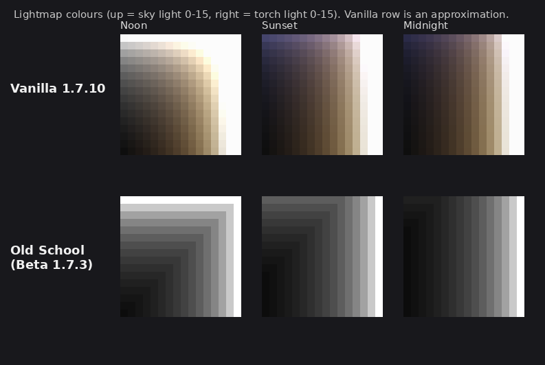

# Old School Lighting (Minecraft 1.7.10 Forge)

Brings back **Beta 1.7.3 lighting**, the base that Better Than Adventure builds on, in Forge 1.7.10.

## What it changes

| | Vanilla 1.7.10 | Old School Lighting |
|---|---|---|
| Torch light | warm orange, flickers | plain white/grey, steady |
| Night | blue tint | neutral grey |
| Darkest light level | 0.0 (pitch black) | 0.05, like Beta (Nether 0.1) |
| Shadows and nights | | deeper by default (adjustable; set contrast 1.0 / night 11 for exact Beta) |
| Sky + torch light | blended in colour | `max(sky, torch)`, like Beta |
| Sunrise / sunset | smooth fade | steps down one light level at a time, like Beta |

It doesn't change gameplay: mob spawning, crop growth and so on still use normal light levels. It's **client-side only**, so it works on any server and does nothing if installed on one.

## Using it

- **L** toggles it on/off so you can compare with vanilla (rebind it under Controls).
- **Mods → Old School Lighting → Config** has the settings (also in `config/oldschoollighting.cfg`):
  - `contrast` (**Shadow strength**): 1.0 = exact Beta (subtle), **1.6 = default**, 2.0+ = very dark and moody
  - `nightDarkening` (**Night darkness**): 11 = exact Beta, **13 = default**, 15 = pitch-black nights
  - `brightnessSliderStrength`: how much the vanilla Brightness slider can wash things out (default 0.5)
  - `steppedDaylight`: Beta-style stepped sunsets (default on), or a smooth fade
  - `useBrightnessSlider`: turn off to ignore the Brightness slider completely
  - `skyAmbient` / `netherAmbient` / `endAmbient`: how bright the darkest areas are
  - `dimensionBlacklist`: dimension IDs that keep vanilla lighting

For the full old-school look, also try **Smooth Lighting: OFF** in Video Settings.

## Building the jar

### Option A: let GitHub build it (no setup)
1. Create a new GitHub repo and upload this folder (or `git push` it; it's already a git repo).
2. Open the **Actions** tab → *Build mod jar* run → download the **OldSchoolLighting** artifact.
3. Use the jar **without** `-dev` or `-sources` in its name.

### Option B: build on your PC
1. Install a JDK 17 or newer (e.g. [Temurin 21](https://adoptium.net/)). Gradle downloads the other Java versions it needs. If it complains about Java 8, install Temurin 8 too.
2. In this folder run:
   - Windows: `gradlew.bat build`
   - Mac/Linux: `./gradlew build`
3. The mod is `build/libs/oldschoollighting-<version>.jar`. Put it in `.minecraft/mods` with Forge 1.7.10 (10.13.4.1614).

To test without installing anything: `gradlew runClient` starts a 1.7.10 dev client with the mod loaded.

## How it works

`EntityRenderer` only rebuilds its 16×16 lightmap when the private `lightmapUpdateNeeded` flag is set. Just before each frame, `LightmapHandler` writes a Beta-style lightmap into that texture and clears the flag (via reflection, no coremod or mixins). The maths is in `BetaLightmap.java` and copies Beta 1.7.3's `generateLightBrightnessTable()` and `calculateSkylightSubtracted()`.

## Known limits

- Mods that replace the lightmap themselves (OptiFine custom lightmaps / dynamic lights, shader packs, Angelica) may override it or clash.
- Beta's smooth lighting had slightly darker block corners. This version doesn't change ambient occlusion; that would need a mixin.
